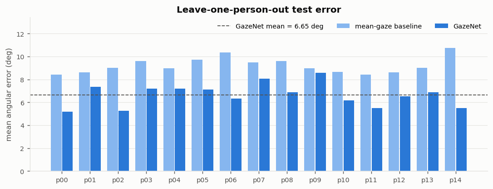
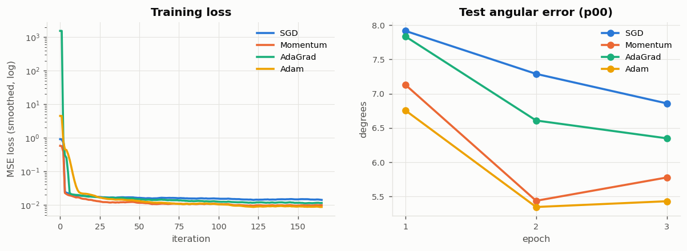
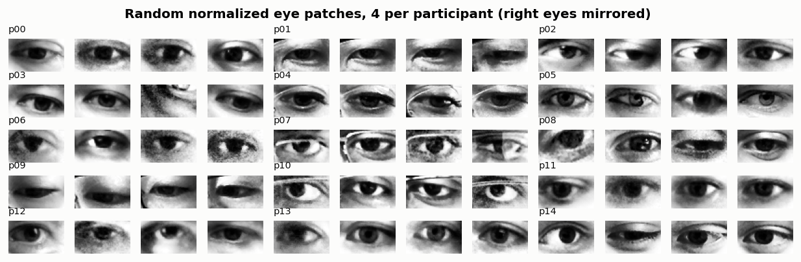
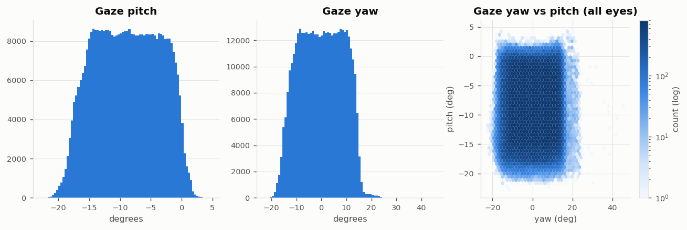

# MPIIGaze Gaze Estimation from Scratch

Appearance-based gaze estimation on the [MPIIGaze](https://www.mpi-inf.mpg.de/departments/computer-vision-and-machine-learning/research/gaze-based-human-computer-interaction/appearance-based-gaze-estimation-in-the-wild) dataset,
built entirely with **NumPy** on top of the code from *Deep Learning from Scratch*
([ssuai/deep_learning_from_scratch](https://github.com/ssuai/deep_learning_from_scratch)).

The model takes a 36x60 grayscale eye patch plus the head pose and regresses the gaze direction
(pitch, yaw). It is evaluated with the standard leave-one-person-out protocol.

## Results

Leave-one-person-out on the standard evaluation subset (train on 14 people, test on the 15th; 42,000 / 3,000 eyes;
Adam, lr 0.001 x0.7 per epoch, batch 100, 3 epochs; about 12 minutes per fold on a laptop CPU).

**Mean angular error: 6.65 deg** vs. 9.21 deg for a constant mean-gaze predictor. GazeNet beats the baseline for
all 15 participants. For reference, Zhang et al. (CVPR 2015) report 6.3 deg for their LeNet-based model.

Angular error in degrees (lower is better):

| | p00 | p01 | p02 | p03 | p04 | p05 | p06 | p07 | p08 | p09 | p10 | p11 | p12 | p13 | p14 | **mean** |
|---|---|---|---|---|---|---|---|---|---|---|---|---|---|---|---|---|
| mean-gaze baseline | 8.43 | 8.63 | 9.00 | 9.60 | 8.97 | 9.73 | 10.34 | 9.49 | 9.61 | 8.97 | 8.66 | 8.43 | 8.60 | 9.00 | 10.75 | **9.21** |
| GazeNet | 5.20 | 7.36 | 5.27 | 7.18 | 7.21 | 7.11 | 6.34 | 8.06 | 6.87 | 8.57 | 6.16 | 5.51 | 6.51 | 6.87 | 5.48 | **6.65** |



Other experiments in `notebooks/02_train_gazenet.ipynb`:

* **Optimizers** (6,000 samples, 3 epochs, test person p00): Adam 5.43 < Momentum 5.78 < AdaGrad 6.35 < SGD 6.86 deg,
  the same ordering as the textbook's ch06 MNIST comparison.
* **Head pose ablation**: 5.63 deg with pose vs. 6.08 deg image only (single run; runs vary by ~0.2 deg).
* **Generalization gap**: 4.9 deg on people seen in training vs. 6.65 deg on the unseen person. Test error barely
  improves after the first epoch, so person-to-person differences, not under-training, limit accuracy.
* **Error analysis (p00)**: yaw is predicted well (r = 0.85), pitch less so (r = 0.69, pulled toward the mean).



**Limitations / next steps**: inputs are not zero-centered (large loss spike in the first iterations); mean-centering,
data augmentation and the textbook's Dropout / BatchNormalization layers are the natural next experiments.
Trained weights (`results/gazenet_pXX.pkl`, 14 MB each) are not committed; `train.py` recreates them.

## Project layout

This folder lives inside a fork of the textbook repository, next to the original chapters. The textbook
files (`ch01`-`ch08`, `common/`, `dataset/`) are left untouched; GazeNet imports the original `common/` package.

```
common/                    (textbook) layers, optimizers, im2col, numerical gradient - used unchanged
mpiigaze/
  download.py              download + extract MPIIGaze (~2.1 GB) into mpiigaze/data/
  dataset.py               .mat loader, angle conversion, caches, load_mpiigaze() (like the textbook's load_mnist)
  layers_ext.py            MeanSquaredLoss layer + 3D angular error
  gaze_net.py              GazeNet: textbook SimpleConvNet extended for 36x60 input, head-pose concat, regression
  trainer.py               RegressionTrainer: textbook Trainer adapted to (image, pose) input and angular error
  train.py                 leave-one-person-out training script
  gradient_check.py        numerical vs. backprop gradient check
  plot_style.py            shared matplotlib style
  notebooks/01_eda.ipynb            exploratory data analysis
  notebooks/02_train_gazenet.ipynb  optimizer comparison, head-pose ablation, LOPO results, error analysis
  figures/                 figures exported by the notebooks
  results/                 per-fold results (JSON) and training logs
```

## What was reused from the textbook and what was added

| Textbook | This project |
|---|---|
| `Convolution`, `Pooling`, `Relu`, `Affine` (`common/layers.py`) | used unchanged inside GazeNet |
| `SGD`, `Momentum`, `AdaGrad`, `Adam` (`common/optimizer.py`) | used unchanged |
| `numerical_gradient` (`common/gradient.py`) | gradient check of the new parts |
| `SimpleConvNet` (`ch07`) | `GazeNet`: two conv blocks, non-square input, head-pose concat, He init |
| `SoftmaxWithLoss` | `MeanSquaredLoss` (regression) |
| `Trainer` (`common/trainer.py`) | `RegressionTrainer`: two inputs, per-epoch shuffling, angular error instead of accuracy |
| `load_mnist` (`dataset/mnist.py`) | `load_mpiigaze`: leave-one-person-out split of the evaluation subset |

```
eye 1x36x60 -> Conv 20@5x5 -> ReLU -> Pool 2x2 -> Conv 50@5x5 -> ReLU -> Pool 2x2
            -> Affine 500 -> ReLU -> [concat head pose (2)] -> Affine 2 -> (pitch, yaw) -> MSE
```

## EDA highlights



* 213,658 face images (427,316 eye patches) from 15 participants, **heavily unbalanced**
  (35,075 images for p03 vs. 1,498 for p13). Training therefore uses the standard evaluation subset
  (3,000 eyes per person).
* Gaze covers a narrow, screen-shaped range: pitch -23 to 5 deg (mean -8.8), yaw about +-22 deg.
  A constant mean-gaze predictor is the baseline to beat.
* Each participant has their own gaze distribution and appearance (glasses, eye shape, blur), so
  generalizing to **unseen people** is the real challenge. That is why the evaluation is leave-one-person-out.
* Head pose varies more than gaze but is only weakly correlated with it in normalized space
  (r = 0.14 for yaw), so most of the signal has to come from the eye image.
* The normalized patches are **already histogram-equalized** (every image has mean ~128, std ~74), so no
  extra equalization is applied.



## How to run

```bash
python3 -m venv .venv && source .venv/bin/activate
pip install -r mpiigaze/requirements.txt
python mpiigaze/download.py                           # ~2.1 GB, extracts to mpiigaze/data/MPIIGaze
python mpiigaze/dataset.py                            # builds the caches (~20 s)
python mpiigaze/gradient_check.py                     # sanity check of backprop
python -u mpiigaze/train.py --test-person p00 --epochs 3   # one fold (~12 min on a laptop CPU)
python -u mpiigaze/train.py --all-folds --epochs 3         # all 15 folds
jupyter notebook mpiigaze/notebooks/
```

`train.py` options: `--optimizer {SGD,Momentum,AdaGrad,Adam}`, `--lr`, `--lr-decay`, `--batch-size`,
`--train-limit N` (quick experiments), `--no-pose` (ablation), `--equalize`.

## Data and license

The dataset is not included in this repository. MPIIGaze is released by the Max Planck Institute for
Informatics under [CC BY-NC-SA 4.0](https://creativecommons.org/licenses/by-nc-sa/4.0/). Please cite:

> X. Zhang, Y. Sugano, M. Fritz, A. Bulling. *Appearance-Based Gaze Estimation in the Wild.* CVPR 2015.

The textbook code comes from *Deep Learning from Scratch* (Koki Saitoh, MIT License, see `../LICENSE.md`).
