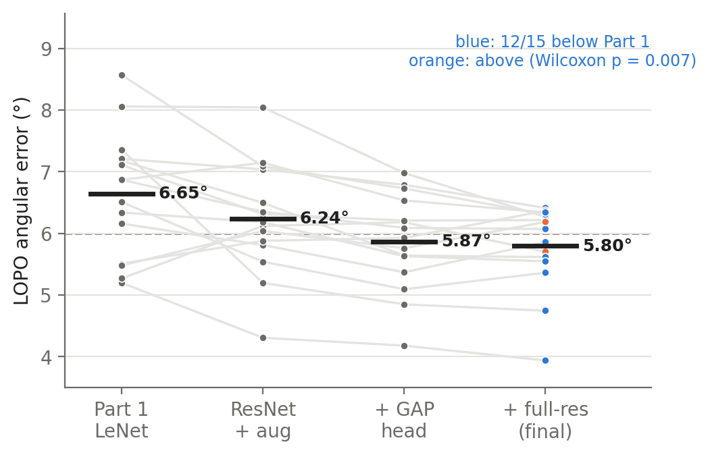
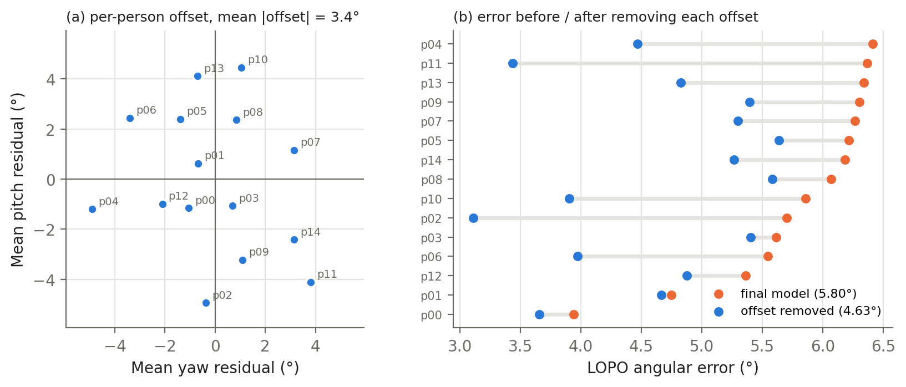

# MPIIGaze 시선 추정 Part 2: NumPy ResNet + Global Average Pooling

딥러닝 Term Project #1 Part 2. Part 1(`../`)의 GazeNet을 개선한 코드와 실험 결과다.
핵심 알고리즘(순전파, 역전파, 옵티마이저)은 교재 *밑바닥부터 시작하는 딥러닝*의 NumPy 레이어를 기반으로 하며, 딥러닝 프레임워크는 사용하지 않는다.

## 결과 (15명 leave-one-person-out, 45,000장 평균)

| 모델 (단일) | 파라미터 | 평균 각도 오차 |
|---|---|---|
| Part 1 GazeNet (LeNet) | 1.8M | 6.65° |
| ResNet (flatten) + 증강 | 2.0M | 6.24° |
| ResNet (GAP) + 증강 | 0.73M | 5.87° |
| **ResNet (GAP, 고해상도) + 증강** | **0.73M** | **5.80°** |

- 최종 모델은 15명 중 12명에서 Part 1보다 낮다 (Wilcoxon 부호순위 검정, p = 0.007).
- 전체 실험 기록: [`results.csv`](results.csv), 요약 표: [`results_summary.md`](results_summary.md), 보고서 원본: [`report/main.tex`](report/main.tex)





## 교재 코드와의 관계

`nn.py`는 교재 `common/layers.py`, `common/optimizer.py`의 레이어를 NHWC 배치로 옮기고 다음을 바꾸거나 추가했다.

- **평탄화 시프트 합성곱**: stride 1 합성곱을 im2col 복사 없이 k² 번의 행렬곱으로 계산 (순전파+역전파 2배 빠름). stride 2와 입력 채널이 적은 층은 교재 im2col 사용.
- **채널별 BatchNorm**, 잔차 블록, Global Average Pooling, 머리 자세 결합, L1 손실, AdamW, 코사인 학습률.
- `test_textbook_equiv.py`: 같은 가중치·입력에서 교재 레이어와 출력·기울기가 일치함을 검사 (결과: `results_textbook_equiv.txt`).
- `gradcheck.py`: 수치 미분 기울기 검사 (결과: `results_gradcheck.txt`).

## 실행 방법

```bash
pip install numpy scipy opencv-python-headless matplotlib
python ../download.py                      # Part 1 스크립트로 MPIIGaze 다운로드 (mpiigaze/data/MPIIGaze)
python prepare_data.py                     # 평가 서브셋 캐시 생성 (MPIIGAZE_ROOT로 경로 지정 가능)
python test_textbook_equiv.py              # 교재 레이어와 일치 확인
python gradcheck.py                        # 기울기 검사
# 최종 모델, LOPO 한 fold (테스트: p00)
python train.py --name L_gapfull_p00 --model resnet --model-kw '{"stem_pool":false,"gap":true}' \
  --epochs 8 --protocol lopo --fold 0 --aug '{"shift":3,"gamma":0.3,"bright":0.1,"contrast":0.25,"noise":0.02}'
python summarize.py                        # results.csv -> results_summary.md
python make_figures.py                     # figures/ 재생성
```

여러 실험은 한 줄에 인자 하나씩 적은 파일을 `./run_queue.sh queue.txt`로 순서대로 실행한다.

## 파일

| 파일 | 내용 |
|---|---|
| `nn.py` | NumPy 레이어, 손실, 옵티마이저 |
| `models.py` | MLP, LeNet, ResNet(flatten/GAP) 정의 |
| `train.py` | 학습·평가 (5-fold 사람 단위 또는 LOPO) |
| `prepare_data.py` | 평가 서브셋 캐시 생성 (오른눈 좌우 반전) |
| `tta_eval.py`, `ensemble.py` | 좌우 반전 TTA, 예측 평균 (보조 실험) |
| `runs/` | LOPO 실험별 학습 곡선(json), 최종 모델 예측(npy) |
| `figures/` | 보고서 그림 |

## 인용

X. Zhang, Y. Sugano, M. Fritz, A. Bulling. *Appearance-Based Gaze Estimation in the Wild.* CVPR 2015.
