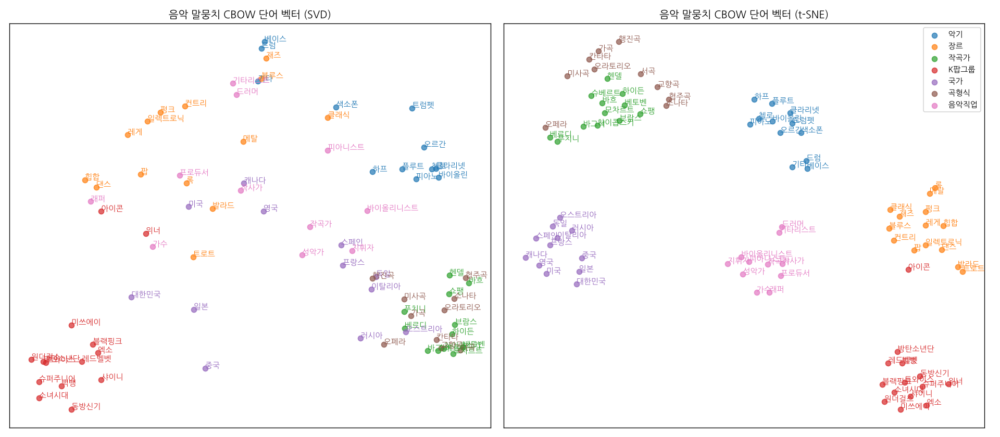

# word2vec 한글 실습: 음악 말뭉치

『밑바닥부터 시작하는 딥러닝 ❷』 4장(word2vec 속도 개선)의 한글 실습입니다.
[ssuai/deep_learning_from_scratch2](https://github.com/ssuai/deep_learning_from_scratch2)의 `ch04/word2vec_korean.ipynb`(김소월 시)와 같은 흐름으로,
**한국어 위키백과 음악 문서**를 모아 교재의 CBOW(Embedding + 네거티브 샘플링)로 학습하고 평가합니다.

**결과 노트북: [`word2vec_music.ipynb`](word2vec_music.ipynb)**

## 결과 요약

평가셋은 직접 만들었습니다: 유추 374문항(악기→연주자, 그룹→소속사, 국가→수도/언어/음악 차트, 작곡가→국적, 남성→여성)과
7개 범주 84단어의 군집 평가(가장 가까운 5개 중 같은 범주 비율, 무작위 약 0.14).

| 설정 (5에폭, hidden 100, 배치 1000, lr 0.003) | 토큰 | 어휘 | 학습 | 유추 top-1 | 유추 top-5 | 범주 P@5 |
|---|---:|---:|---:|---:|---:|---:|
| 규칙 기반 토큰 / CBOW 윈도우 5 | 219만 | 16,220 | 28분 | 0.321 | 0.603 | 0.760 |
| Kiwi / CBOW 윈도우 5 | 251만 | 12,687 | 29분 | 0.358 | 0.660 | 0.835 |
| Kiwi / CBOW 윈도우 2 | 251만 | 12,687 | 21분 | 0.230 | 0.540 | **0.896** |
| Kiwi / Skip-gram 윈도우 2 | 251만 | 12,687 | 46분 | 0.345 | 0.652 | 0.880 |
| Kiwi / CBOW 윈도우 5, 문서 10% | 50만 | 4,190 | 5분 | 0.163 | 0.332 | 0.731 |
| Kiwi / CBOW 윈도우 5, 문서 25% | 125만 | 7,922 | 13분 | 0.226 | 0.479 | 0.785 |
| **Kiwi / CBOW 윈도우 5, 전체** | 517만 | 20,276 | 72분 | **0.479** | **0.826** | 0.889 |

* 말뭉치 크기의 영향이 가장 컸고, 형태소 분석(Kiwi)이 규칙 기반 조사 분리보다 나았습니다.
* 윈도우가 좁으면 같은 종류끼리(범주), 넓으면 함께 나오는 관계(유추)를 더 잘 잡았습니다. Skip-gram은 CBOW보다 유추에 강하지만 2배 넘게 느렸습니다.
* 교재 `analogy()`에 정규화하지 않은 벡터를 넣으면 노름이 큰 단어가 늘 답으로 나와서, `normalize()` 후 풀어야 했습니다.
* 예: `피아노 → 첼로, 바이올린, 신시사이저`, `미국:빌보드 = 일본:오리콘`, `엑소:SM = 트와이스:JYP`



## 구성

| 파일 | 내용 |
|---|---|
| `dataset/make_music.sh` | 말뭉치를 처음부터 다시 만드는 스크립트 (kowikitext 약 500MB 다운로드) |
| `dataset/filter_music.py` | 정의문 서술부로 음악 문서 고르기 (84.7만 문서 → 2.7만) |
| `dataset/clean_music.py` | 괄호·목록·중복 제거, 서술문만 남김 (→ 2만 문서, 22만 문장, 1,350만 글자) |
| `dataset/tokenize_music.py` | 규칙 기반(`common/korean.py`) / Kiwi 토큰화 |
| `dataset/music_clean.txt.gz` | 정제된 말뭉치 (출처: 한국어 위키백과, CC BY-SA, [kowikitext](https://github.com/lovit/kowikitext) 2020-09-20) |
| `music_data.py` | 토큰 파일 → `(corpus, word_to_id, id_to_word)` |
| `train_music.py` | 교재 `ch04/train.py` 의 음악 말뭉치 버전 |
| `eval_music.py`, `eval/` | 유추·범주 평가 코드와 평가셋 |
| `results/*.pkl` | 학습된 단어 벡터와 손실 기록 |
| `common/`, `cbow.py`, `skip_gram.py`, `negative_sampling_layer.py` | 밑바닥 2권 코드(MIT, ssuai 저장소) 그대로. 1권의 `common/`과 섞이지 않게 이 폴더 안에 따로 둠 |

교재 코드에서 바꾼 점은 두 가지입니다. 네거티브 샘플은 교재 GPU 경로와 같은 방식(배치 전체를 한 번에 뽑음)으로 CPU에서도 뽑고,
배치를 1000으로 키웠습니다. 교재 `Embedding.backward()`와 `Adam`이 매 반복 (어휘 수 × 100) 행렬 전체를 다뤄서, 배치 100이면 1에폭에 1시간이 넘게 걸렸기 때문입니다.

## 실행

```bash
pip install numpy matplotlib kiwipiepy scikit-learn
cd word2vec_music
python train_music.py --tokenizer kiwi --model cbow --window 5 --batch 1000 --lr 0.003 --epoch 5 --min_count 10 --frac 1.0
python eval_music.py results/*.pkl
```
처음 실행하면 `music_clean.txt.gz`에서 토큰 파일을 만듭니다(약 1분). Colab에서는 노트북 첫 셀이 저장소 복제와 설치를 해 줍니다.
