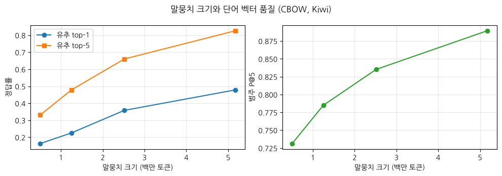
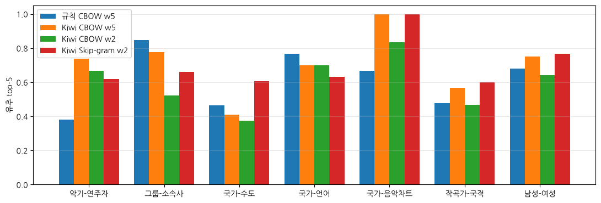
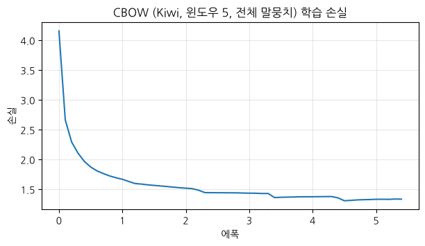

# 음악 분야 한글 말뭉치를 이용한 word2vec 학습 및 평가

『밑바닥부터 시작하는 딥러닝 ❷』 4장 「word2vec 속도 개선」 한글 실습 보고서

- 실험 노트북: [`word2vec_music.ipynb`](word2vec_music.ipynb)
- 참고: [ssuai/deep_learning_from_scratch2](https://github.com/ssuai/deep_learning_from_scratch2) `ch04/word2vec.ipynb`, `ch04/word2vec_korean.ipynb`

## 요약

한국어 위키백과에서 음악 문서 약 2만 편(형태소 기준 517만 토큰)을 모아, 교재의 CBOW 모델(Embedding 계층과 네거티브 샘플링)로 단어 벡터를 학습했다.
학습한 벡터를 평가하려고 유추 문제 374개와 범주 군집 평가셋(7개 범주, 84단어)을 직접 만들었다.
가장 좋은 모델은 전체 말뭉치를 Kiwi로 형태소 분석해 학습한 CBOW였다. 이 모델은 유추 top-5 정답률 0.826, 범주 군집 정확도(P@5) 0.889를 기록했다.
비교 실험에서는 **말뭉치 크기**가 성능에 가장 크게 영향을 줬다. **형태소 분석기**를 쓴 쪽이 규칙 기반 조사 분리보다 나았다.
**윈도우 크기**에 따라 단어 벡터가 담는 관계의 종류가 달라졌다.

## 1. 목표

교재 4장의 한글 예제는 김소월의 시 168편(1.3만 토큰)으로 CBOW를 학습한다.
그런데 말뭉치가 작아서 어휘의 30%가 `<unk>`가 되고, 유사 단어 검색 결과도 불안정하다(예: `님` → `몹쓸`, `물가`).
이 과제의 목표는 다음 세 가지다.

1. 관심 분야(음악)의 한글 말뭉치를 교재 예제보다 충분히 크게 직접 수집한다.
2. 교재의 word2vec 구현을 그대로 사용해 단어 벡터를 학습한다.
3. 결과를 눈으로 보는 데 그치지 않고, 설정을 바꿔 가며 **정량적으로 비교**할 수 있는 평가 체계를 만든다.

## 2. 데이터

### 2.1 수집

| 단계 | 방법 | 결과 |
|---|---|---|
| 원본 | [kowikitext](https://github.com/lovit/kowikitext): 한국어 위키백과 2020-09-20 덤프를 문서 단위로 정리한 공개 데이터 (CC BY-SA) | 846,797 문서 |
| 음악 문서 선별 | 문서 정의문(첫 문장)의 서술부 끝 40글자에 음악 명사(가수, 음반, 노래, 작곡가, 밴드, 교향곡, 악기, 장르 등)가 있는 문서만 선택 | 26,811 문서 |
| 정제 | 괄호 속 원어·한자·생몰년 삭제, `~다.`로 끝나는 서술문만 유지(목록·표 제거), 문서 내 중복 문장 삭제, 한글 비율 60% 미만 문장 삭제 | **19,977 문서, 220,307 문장, 1,353만 글자** |

처음에는 정의문 전체에서 키워드를 찾았다. 그랬더니 `조세법률주의`, `FN M1900`(싱글 액션 권총), `안남초등학교`(옥천군 안남면 *연주*리) 같은 문서가 섞여 들어왔다.
그래서 판단 기준을 "이 문서는 무엇인가"를 말하는 서술부로 좁혔다.
선별된 문서는 K팝 가수와 음반, 서양 고전음악(작곡가, 작품, 악기), 대중음악 장르, 해외 밴드 등 음악 전반을 다룬다.

### 2.2 토큰화

위키백과 문장은 시보다 길고 활용형이 다양하다. 그래서 두 가지 토크나이저를 만들어 비교했다(`dataset/tokenize_music.py`).

| | 규칙 기반 (교재 `common/korean.py`) | Kiwi 형태소 분석기 |
|---|---|---|
| 방식 | 어절 끝 조사만 규칙으로 분리 | 형태소 분석 후 용언은 기본형(`남겼다` → `남기다`), 조사는 `-를`처럼 표기, 어미 삭제 |
| `쇼팽은 … 작곡가이자 피아니스트로 … 남겼다` | `쇼팽 -은 … 작곡가이자 피아니스트 -로 … 남겼다` | `쇼팽 -은 … 작곡가 -이다 피아니스트 -로 … 남기다` |
| 전체 토큰 수 | 451만 | 517만 |
| 어휘 수 (`min_count=10`) | 28,658 | 20,276 |
| `<unk>` 비율 | 10.1% | 4.5% |

규칙 기반 방식에서는 `작곡가이자`, `그룹이다`, `데뷔한`처럼 어미가 붙은 형태가 모두 서로 다른 단어가 된다.
그래서 어휘가 커지고, 같은 단어의 통계가 여러 형태로 흩어진다.

## 3. 방법

### 3.1 모델

교재 4장의 구현을 그대로 사용했다.

- **CBOW**: 맥락 단어들의 Embedding 평균으로 가운데 단어를 예측한다(`cbow.py`).
- **Skip-gram**: 가운데 단어로 맥락 단어 각각을 예측한다(`skip_gram.py`).
- **Embedding 계층**: 원-핫 벡터와 가중치 행렬의 곱 대신 해당 행을 뽑아 쓴다.
- **네거티브 샘플링**: 어휘 전체에 대한 Softmax 다중 분류를, 정답 1개와 오답 5개에 대한 Sigmoid 이진 분류로 바꾼다. 오답은 unigram 분포의 0.75제곱으로 뽑는다.
- 은닉층 100차원, Adam 최적화, 5에폭, `min_count=10`.

### 3.2 교재 코드에서 바꾼 점

교재 코드를 그대로 쓰면 어휘가 1만 개를 넘는 이 말뭉치를 CPU에서 학습할 수 없을 만큼 느렸다. 그래서 두 부분을 바꿨다.

1. **네거티브 샘플 추출.** 교재 `UnigramSampler`의 CPU 경로는 샘플마다 확률표를 복사하고 `np.random.choice`를 따로 호출한다.
   이것을 교재 GPU 경로와 같은 방식으로 바꿔 배치 전체를 한 번에 뽑게 했다. 분포는 같고, 정답 단어가 오답으로 뽑힐 수 있다는 점만 다르다.
2. **배치 크기 1000, 학습률 0.003.** 교재 `Embedding.backward()`는 반복마다 (어휘 수 × 100) 크기의 기울기 행렬 전체를 0으로 초기화한다. `Adam`도 행렬 전체를 갱신한다.
   그래서 반복 1회의 비용이 배치 크기보다 어휘 수에 좌우된다. 배치 100으로는 250만 토큰 1에폭에 1시간이 넘게 걸렸다.
   배치를 1000으로 키워 반복 횟수를 1/10로 줄이고, 줄어든 갱신 횟수만큼 학습률을 올렸다.
   같은 조건으로 2에폭을 학습했을 때 lr 0.001은 유추 top-5 0.291, lr 0.003은 0.564였다.

### 3.3 평가 방법

평가셋은 직접 만들었다(`eval/build_testsets.py`, 사실관계는 위키백과 기준).

**유추 평가 (374문항).** `a : b = c : ?` 형식이다. 교재 `analogy()`와 같은 방식으로 풀었다.
`b − a + c` 벡터와 코사인 유사도가 가장 큰 단어(a, b, c 제외)가 정답이면 top-1, 상위 5개 안에 있으면 top-5로 셌다.

| 관계 | 예시 | 문항 |
|---|---|---:|
| 악기 → 연주자 | 피아노 : 피아니스트 = 바이올린 : 바이올리니스트 | 42 |
| 그룹 → 소속사 | 엑소 : SM = 트와이스 : JYP | 94 |
| 국가 → 수도 | 일본 : 도쿄 = 프랑스 : 파리 | 56 |
| 국가 → 언어 | 독일 : 독일어 = 일본 : 일본어 | 30 |
| 국가 → 음악 차트 | 미국 : 빌보드 = 일본 : 오리콘 | 6 |
| 작곡가 → 국적 | 쇼팽 : 폴란드 = 베르디 : 이탈리아 | 90 |
| 남성 → 여성 | 남성 : 여성 = 테너 : 소프라노 | 56 |

**범주 군집 평가 (84단어).** 악기, 장르, 작곡가, K팝 그룹, 국가, 곡 형식, 음악 직업의 7개 범주로 구성했다.
단어마다 평가 단어 전체에서 가장 가까운 5개를 찾고, 그중 같은 범주의 비율(precision@5)을 평균했다. 무작위로 고르면 약 0.14다.

## 4. 결과

### 4.1 비교 실험

모든 실험은 5에폭, 은닉층 100, 배치 1000, lr 0.003이다. 학습 시간은 4코어 CPU에서 여러 실험을 동시에 돌린 기준이다.

| 실험 | 설정 | 토큰 | 어휘 | 학습 시간 | 유추 top-1 | 유추 top-5 | 범주 P@5 |
|---|---|---:|---:|---:|---:|---:|---:|
| 토크나이저 | 규칙 기반 / CBOW 윈도우 5 / 문서 50% | 219만 | 16,220 | 28분 | 0.321 | 0.603 | 0.760 |
| | Kiwi / CBOW 윈도우 5 / 문서 50% | 251만 | 12,687 | 29분 | 0.358 | 0.660 | 0.835 |
| 모델·윈도우 | Kiwi / CBOW 윈도우 2 / 문서 50% | 251만 | 12,687 | 21분 | 0.230 | 0.540 | **0.896** |
| | Kiwi / Skip-gram 윈도우 2 / 문서 50% | 251만 | 12,687 | 46분 | 0.345 | 0.652 | 0.880 |
| 말뭉치 크기 | Kiwi / CBOW 윈도우 5 / 문서 10% | 50만 | 4,190 | 5분 | 0.163 | 0.332* | 0.731 |
| | Kiwi / CBOW 윈도우 5 / 문서 25% | 125만 | 7,922 | 13분 | 0.226 | 0.479* | 0.785 |
| | Kiwi / CBOW 윈도우 5 / 문서 50% | 251만 | 12,687 | 29분 | 0.358 | 0.660 | 0.835 |
| | **Kiwi / CBOW 윈도우 5 / 문서 100%** | 517만 | 20,276 | 72분 | **0.479** | **0.826** | 0.889 |

\* 평가 단어 중 `min_count` 미만인 단어가 있어 일부 문항만 풀 수 있었다(10%: 202문항, 25%: 332문항).
규칙 기반은 358문항, 나머지는 374문항 전부를 풀었다.





### 4.2 최종 모델 (Kiwi, CBOW, 윈도우 5, 전체 말뭉치)

학습 손실은 4.16에서 1.34로 줄었다.



**유사 단어 (코사인 유사도 상위 5개)**

| 질의 | 결과 |
|---|---|
| 피아노 | 첼로, 바이올린, 신시사이저, 쳄발로, 비올라 |
| 재즈 | 클래식, 아방가르드, 블루스, 퓨전, 뉴올리언스 |
| 쇼팽 | 베토벤, 연습곡, 슈만, 모차르트, 멘델스존 |
| 방탄소년단 | 빅뱅, 지드래곤, 레드벨벳, 포미닛, 케이팝 |
| 소프라노 | 테너, 바리톤, 성악가, 콜로라투라, 음역 |
| 트로트 | 정통, 발라드, 가요, 탱고, 설운도 |
| 데뷔 | 데뷰, 복귀, 컴백, 발돋움, 전향 |

**유추 예시**

| 문제 | 상위 3개 예측 | |
|---|---|---|
| 피아노 : 피아니스트 = 바이올린 : ? | 바이올리니스트, 조각가, 오르가니스트 | 정답 |
| 일본 : 도쿄 = 프랑스 : ? | 파리, 하노이, 취리히 | 정답 |
| 미국 : 빌보드 = 일본 : ? | 오리콘, TOKIO, ZARD | 정답 |
| 엑소 : SM = 트와이스 : ? | JYP, YG, 스타쉽 | 정답 |
| 남성 : 여성 = 테너 : ? | 소프라노, 바리톤, 모나코 | 정답 |
| 모차르트 : 오스트리아 = 쇼팽 : ? | 헝가리, 스위스, 폴란드 | top-5 안 |
| 남자 : 여자 = 왕 : ? | 시신, 크레인, 총장 | 오답 |

**범주별 성능**

| 유추 관계 | top-1 | top-5 | | 범주 | P@5 |
|---|---:|---:|---|---|---:|
| 악기 → 연주자 | 0.333 | 0.833 | | 악기 | 0.98 |
| 그룹 → 소속사 | 0.670 | 0.957 | | 장르 | 0.91 |
| 국가 → 수도 | 0.321 | 0.661 | | 작곡가 | 0.92 |
| 국가 → 언어 | 0.367 | 0.867 | | K팝 그룹 | 0.94 |
| 국가 → 음악 차트 | 0.667 | 1.000 | | 국가 | 0.97 |
| 작곡가 → 국적 | 0.289 | 0.756 | | 곡 형식 | 0.48 |
| 남성 → 여성 | 0.768 | 0.839 | | 음악 직업 | 0.95 |


t-SNE로 줄여 그린 2차원 그림에서도 악기, 장르, 작곡가, K팝 그룹, 국가가 각각 뚜렷한 군집을 이룬다.

## 5. 분석

**말뭉치 크기의 영향이 가장 컸다.** 문서를 10%에서 100%로 늘리는 동안 유추 top-5는 0.33에서 0.83으로, 범주 P@5는 0.73에서 0.89로 꾸준히 올랐다. 100%에서도 아직 포화되지 않았다.
1.3만 토큰짜리 김소월 예제와 달리 유사 단어와 유추 결과가 대부분 납득할 만하다.
다만 말뭉치가 커지면 같은 5에폭이라도 갱신 횟수와 어휘 수가 함께 늘어난다. 따라서 이 차이가 순수하게 데이터 양만의 효과는 아니다.

**형태소 분석이 규칙 기반보다 나았다.** 같은 문서에서 Kiwi는 어휘가 더 작고 `<unk>`도 적었다(6.2% 대 13.2%).
범주 P@5(0.835 대 0.760)와 유추 top-5(0.660 대 0.603) 모두 앞섰다. 특히 악기 → 연주자 유추(0.74 대 0.38)와 음악 직업 범주(0.84 대 0.58)에서 차이가 컸다.
`피아니스트로`, `작곡가이자`처럼 어미가 붙은 형태가 흩어지지 않고 한 단어로 모였기 때문이다.
반대로 Kiwi는 `빅히트`를 `빅`과 `히트`로 쪼개는 등 고유명사를 자르는 문제가 있었다. 그래서 그룹 → 소속사 유추에서는 규칙 기반이 더 높았다(0.85 대 0.78).

**윈도우 크기에 따라 담기는 관계가 달랐다.** 윈도우 2는 범주 P@5가 0.896으로 가장 높았지만, 유추 top-5는 0.540으로 윈도우 5(0.660)보다 낮았다.
좁은 문맥은 같은 자리에 올 수 있는 단어, 즉 같은 종류의 단어(악기끼리, 작곡가끼리)를 잘 묶는다.
넓은 문맥은 그룹과 소속사, 작곡가와 국적처럼 **함께 등장하는 관계**를 더 잘 담는다.

**Skip-gram은 유추에 강했지만 느렸다.** 같은 윈도우 2에서 Skip-gram은 유추 top-5가 0.652로 CBOW(0.540)보다 높았다. 특히 국가 → 수도(0.61 대 0.38)와 드문 단어가 많은 곡 형식 범주(0.58 대 0.38)에서 좋았다.
Skip-gram은 맥락 단어마다 손실을 따로 계산하므로 드문 단어도 학습 신호를 더 많이 받는다. 대신 학습 시간은 CBOW의 2.2배였다.

**교재 `analogy()`는 벡터를 정규화해야 제대로 동작했다.** 학습된 벡터를 그대로 넣으면 `피아노 : 피아니스트 = 바이올린 : ?`의 답으로 `후임`, `지휘자`가 먼저 나오고, 정답 `바이올리니스트`는 3위로 밀렸다.
`analogy()`는 질의 벡터만 정규화하고 단어 행렬은 정규화하지 않은 채 내적한다. 그래서 여러 문맥에 두루 나와 벡터 길이가 큰 단어가 어느 질문에서나 위로 올라온다.
교재 `normalize()`로 단어 벡터를 먼저 정규화하자 `바이올리니스트`가 1위로 올라왔다. 이 보고서의 정량 평가는 모두 정규화한 벡터로 했다.

**틀린 문제의 경향.** 오답 대부분은 관계의 방향은 맞지만 같은 범주 안에서 헷갈린 경우였다. 예를 들어 `브람스 : 독일 = 차이콥스키 : ?`에 `오스트리아`, `러시아` 순으로 답했다.
`남자 : 여자 = 왕 : ?`는 끝까지 틀렸다. 음악 문서에는 왕과 여왕이 나오는 문맥이 거의 없기 때문이다. 단어 벡터는 말뭉치가 다루는 범위의 의미만 배운다.
곡 형식 범주(칸타타, 오라토리오, 미사곡 등)는 모든 설정에서 성능이 가장 낮았다. 이 단어들은 등장 횟수가 적고, `작곡하다`, `초연` 같은 문맥을 작곡가·악기 이름과 공유한다.

## 6. 한계와 향후 과제

- 평가셋은 직접 만든 소규모 데이터(유추 374문항, 84단어)라 일반적인 품질 지표로 보기는 어렵다.
- 실험마다 시드 하나로 한 번씩만 학습해서, 작은 차이는 오차 범위일 수 있다.
- 학습 시간 때문에 비교 실험은 문서 50%로 했고, 에폭과 은닉층 크기는 바꿔 보지 못했다.
- 개선 방향: 전체 말뭉치로 Skip-gram 학습, Kiwi 사용자 사전에 고유명사(`빅히트`, `SM엔터테인먼트`) 추가, 희소 갱신(Embedding이 쓰는 행만 갱신)으로 학습 속도 개선.

## 부록 A. 재현 방법

```bash
pip install numpy matplotlib kiwipiepy scikit-learn
cd word2vec_music

# (선택) 말뭉치를 처음부터 다시 만들기: kowikitext 약 500MB 다운로드
bash dataset/make_music.sh

# 학습 (처음 실행하면 dataset/music_clean.txt.gz에서 토큰 파일을 만든다, 약 1분)
python train_music.py --tokenizer kiwi --model cbow --window 5 --batch 1000 --lr 0.003 --epoch 5 --min_count 10 --frac 1.0

# 평가
python eval_music.py results/*.pkl
```

Colab에서는 노트북 첫 셀이 저장소 복제와 패키지 설치를 해 준다.

## 부록 B. 파일 구성

| 파일 | 내용 |
|---|---|
| `word2vec_music.ipynb` | 실험 노트북 (수집, 토큰화, 학습, 평가, 비교 실험, 시각화) |
| `dataset/make_music.sh` | 말뭉치 생성 전체 과정 |
| `dataset/filter_music.py`, `clean_music.py`, `tokenize_music.py` | 음악 문서 선별, 정제, 토큰화 |
| `dataset/music_clean.txt.gz` | 정제된 말뭉치 (한국어 위키백과, CC BY-SA) |
| `music_data.py` | 토큰 파일을 교재 형식 `(corpus, word_to_id, id_to_word)`로 변환 |
| `train_music.py` | 학습 스크립트 (교재 `ch04/train.py` 기반) |
| `eval_music.py`, `eval/` | 평가 코드와 평가셋 |
| `results/*.pkl` | 학습된 단어 벡터와 손실 기록 |
| `figures/` | 보고서 그림 |
| `common/`, `cbow.py`, `skip_gram.py`, `negative_sampling_layer.py` | 『밑바닥부터 시작하는 딥러닝 ❷』 코드 (MIT 라이선스). 저장소의 1권 `common/`과 섞이지 않게 이 폴더에 따로 둠 |
